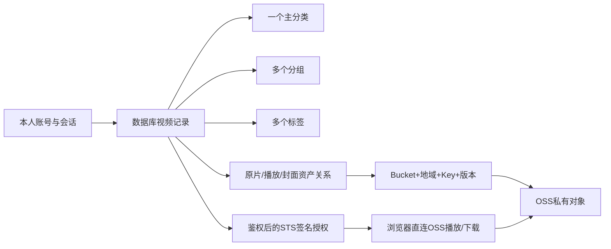

# 第二阶段：三代理任务与新对话入口

日期：2026-10-02。**三个子代理阶段2任务已完成，包含授权正式库v2迁移和本机真实STS/OSS完整链验收；原账号/数据库/公开对象保留。** 本轮具体授权范围外的写入/权限变更仍单独审阅。最终证据见[完成审计](../STAGE2_COMPLETION_AUDIT.md)、[主控记录](../STAGE2_INTEGRATION.md)和三个任务板。

最新依据：[OSS和框架调整相关](OSS和框架调整相关.md)、[自定义策略JSON](自定义策略的json.txt)及用户补充确认；评审结论、代码影响与官方依据：[架构调整评审](STAGE2_ARCHITECTURE_REVIEW.md)。旧任务中的A/proxy默认与“禁止B”不再作为本阶段约束；已实现行为仍以源码及当前API契约为准。

本地真实OSS所需材料/配置及验收清单见[OSS_LOCAL_TEST_PLAN](../OSS_LOCAL_TEST_PLAN.md)。第二阶段完成应包含P2-MEDIA-05的本机真实STS/OSS上传、直连/续签与下载验收，不能只完成Fake代码后宣称实云完成。[第三阶段](STAGE3.md)负责服务器部署、杭州内网上传、最终域名/安卓真机与运维交接，不重复第二阶段功能。

最新准备：OSS证书已生效，样例匿名HEAD/TLS通过，证书到期2026-12-30 23:59:59 UTC；用户确认样例公共读，匿名成功符合预期。可启动第二阶段开发，私有业务对象范围/STS/CORS等按卡核验，不把公开样例当私有授权证据；网站部署仍归第三阶段，完整清单见[本地实云计划](../OSS_LOCAL_TEST_PLAN.md#6-新对话启动第二阶段的剩余事项)。

## 1. 目前事实与本阶段目标

- CORE-01～03 已有工程、真SQLite Repository、本人密码/TOTP登录与会话；媒体/前端独立模块及Mock已交付。
- 当前服务器入口已装配真实auth、组织/视频库、观看记录/用量和media；隔离真HTTP/SQLite及本机真实STS/OSS完整链均已验证，证明范围分别记录，不用Mock替代实云。
- 用户明确要求：登录与业务都持久化；视频有一个主分类、多个分组与多个标签；上传/导入时选组织信息，数据库管理OSS对象位置及关联；明确SDK和材料。
- 本阶段完成真实HTTP+SQLite的组织/库/上传登记/播放/续播链。真实OSS选择 `PLAYBACK_MODE=oss`：上传仍经服务器，播放/下载由服务器鉴权并用STS签名后直连OSS；保留显式proxy用于开发/兼容，不隐式切换。
- 用户Bucket=`xzlbucket`/地域=`cn-hangzhou`/前缀=`onlineVideo/`及Get/Put/List角色已真实验：三用途STS、2对象private上传/匿名拒绝/签名读取、下载/自动续签/限定List与read不能Put均通过。当前原生video播放不需crossOrigin；额外fetch CORS不可读准确记录，未修改规则，原Bucket公共读及旧样例保留。
- 最新只读核对：sqlite-test.db保留24张表、users与迁移记录为空；正式.local/data/video-library.db已授权升级，ledger为1/2、本人账号1条、实际验收视频/完成上传各2条、兼容观看记录1条位置2秒、完整性正常。备份与账号保留报告见主控记录，不重复建表、迁移或初始化账号。

## 2. 数据与地址模型

| 信息 | 存放位置 |
| --- | --- |
| 登录/密码/TOTP/会话/恢复/失败限流 | 已有users/login_sessions/recovery_codes/login_attempts/audit_events；密码哈希、TOTP密文、Cookie摘要，秘密不进SQL源码 |
| 视频主分类 | categories + videos.category_id（一个主分类） |
| 分组/合集 | library_groups + video_group_links（多个分组） |
| 内容标签 | tags + video_tag_links（多个标签） |
| 上传过程的组织选择 | upload_group_links/upload_tag_links及已有upload_tasks.category_id |
| OSS永久定位/版本/校验 | storage_objects：provider、Bucket、region、objectKey、可选versionId、HEAD元数据 |
| 视频原片/播放/封面与对象 | video_assets；上传对象关联为upload_storage_objects |
| 云操作和登记恢复 | storage_operations + 已有任务/分片状态，登记由SQL事务负责 |



上传得到的Location可用于核对，但数据库长期存完整对象定位，不把过期签名URL当永久地址。签名URL在有效期内本身代表临时访问授权，不依赖站点Cookie；程序在发放/续签前做归属和会话检查。组/标签是SQLite里的业务信息，组织调整不搬移/复制/删除原片。当前Bucket未开版本控制，versionId为null，仍需唯一Key与防覆盖。

## 3. 三个子代理与协作门槛

| 代理 | 阶段任务板 | 核心产出 |
| --- | --- | --- |
| 1：后端与数据库 | [01-backend](../../.ai/demand/stage2/01-backend.md) | 正式库版本2迁移、proxy/oss及续签/下载/用量契约、组织/库/进度真API、安全装配 |
| 2：OSS与视频 | [02-media](../../.ai/demand/stage2/02-media.md) | 上传/签名身份和Endpoint分离、STS缓存/V4签名、续签/下载、上传原子登记及实云验收 |
| 3：前端与真实链路 | [03-frontend](../../.ai/demand/stage2/03-frontend.md) | 组织UI、真API上传、OSS直连播放器/下载/到期恢复、真实边界提示与移动验收 |

**G0**：代理1先完成P2-CORE-01并交接可编译契约/SQL/依赖；同时冻结播放模式、sourceExpiresAt/续签、下载授权、STS凭证提供者及直连用量未知语义。代理2/3可准备自有设计/Fake，不能抢改共享接口。

**G1**：契约冻结后并行开发；代理1是schema/shared/根锁/API入口唯一写入方，代理2只改media与自有测试，代理3只改apps/web。依赖安装串行；各自任务板各自回写，主控同步TASKS。

**G2**：真SQL+真AuthGuard+本地OSS协议/签名替身验证上传、直连模式、续签与下载；proxy旧检查保留。隔离检查、正式迁移、真实OSS、安卓/内网分别有证据。正式迁移先备份/SQL审核/用户授权；不把手工结构库当正式目标。

**G3**：样例已确认公共读，无需重复排查匿名HEAD成功。确认本人私有视频/新上传范围，选私有对象验证匿名拒绝/STS签名成功，并核验信任/AssumeRole、Get/Put/List实效、CORS及具体费用/范围后受控实云验收。媒体HTTPS已就绪，网站/服务器/安卓归第三阶段；不自动改权限/部署。

## 4. SQL、配置与不变边界

- 已有库升级SQL：[STAGE2_PENDING.sql](../sql/STAGE2_PENDING.sql)；执行前读[SQL说明](../sql/README.md)。新环境基线仍是0001/account:init，已有账号不重建。
- 新空库完整结构与逐行中文说明：[01_EMPTY_DATABASE_FULL.sql](../sql/01_EMPTY_DATABASE_FULL.sql)。仅供手工建结构/学习，不能复制成已有库的0002升级迁移，不写虚假ledger。
- 当前迁移器已支持有序0001/0002、Drizzle/版本/SHA校验；正式库已获授权升级至版本2，手工24表库保留。后续迁移仍需独立目标/备份/授权；不重复手工建表、不伪造ledger、不修改0001哈希、不清空/回滚。
- 当前实际库默认.local/data/video-library.db，不碰sqlite-test.db；用户在数据库工具中打开的文件不强制关闭。
- 第二阶段契约来源：[STAGE2_API_CONTRACT](../STAGE2_API_CONTRACT.md)已冻结为共享类型/实际API；[API_CONTRACT](../API_CONTRACT.md)记录当前运行事实，实云未验部分不得说成已通过。
- SDK与材料：[OSS_SETUP](../OSS_SETUP.md)。复用Node.js ali-oss，上传优先沿用已实现的流式分片协议；不能把一次性请求流直接传给高层multipartUpload。依赖归属/STS SDK由代理1串行处理，保留用户已安装依赖。
- 上传读取OSS_ENDPOINT，本地显式公网、部署内网；签名使用独立固定OSS_PLAYBACK_ENDPOINT及cname:true。策略已同时绑定RAM用户/角色，优先复用角色STS按用途收窄：读取签名仅GetObject，上传/导入保留必要动作，凭证缓存按用途隔离，不自动扩大权限。
- URL最大3600秒，实际到期取STS剩余时间与URL期限最小值并留安全余量，前端续签恢复位置。退出/撤销只能拒绝后续签发，不能承诺立即废止已发URL；应用并发不等于OSS连接数。
- proxy保留实际字节预留/结算；oss直连实际传输字节在应用侧未知，独立统计状态与页面提示，不沿用代理硬限额或费用封顶承诺。云监控/日志接入另立任务，不自动开通。
- 不实施Docker/Nginx部署、PWA离线视频、公开注册/分享或永久删除；不擅自改云策略/版本控制/清理分片。OSS证书已生效，网站证书/域名归第三阶段，不要求重复申请OSS证书。
- 所有秘密、库/备份、.local、真实.env不进Git/前端/日志。保留已有暂存内容，不自行提交、推送、切分支或改历史。

## 5. 与旧任务的映射

| 旧执行缺口 | 新阶段负责卡 |
| --- | --- |
| CORE-04：分类/库/元数据 | P2-CORE-02/03 |
| CORE-05：进度/会话/用量 | P2-CORE-04，复用CORE-03现有会话 |
| CORE-06：模块装配 | P2-CORE-05/06 |
| MEDIA/WEB上阶段独立模块DONE | 本阶段改造与真实接入，不重写或假设无需验证 |
| INT-01～03 | 主控在本阶段三方交付后执行，真安卓/OSS项按条件补验 |

新对话按阶段2看板逐卡推进，旧任务板保留历史。主控从实际结果更新旧总览映射，避免两套卡重复开发或一方虚报完成。

## 6. 可复制到新对话的主控提示词

以下为启动时的原始协作约定。阶段2现已完成，新对话先读完成审计/任务板的DONE证据，不重复启动开发、迁移、上传或账号初始化；第三阶段使用独立入口和授权范围。

```text
在 E:\onlineVideo 开始第二阶段开发。
读取用户全局规则、docs/task/STAGE2.md、docs/task/STAGE2_ARCHITECTURE_REVIEW.md、docs/task/OSS和框架调整相关.md、docs/task/自定义策略的json.txt、docs/PRD.md、docs/task/TASKS.md、docs/API_CONTRACT.md、docs/STAGE2_API_CONTRACT.md、docs/sql/README.md、docs/sql/STAGE2_PENDING.sql、docs/OSS_SETUP.md 和三个 .ai/demand/stage2/ 任务板。
本次明确授权代码开发、隔离验证与三个子代理协作；不要重复CORE-01～03或本人账号初始化，检查实际文件/数据库状态。
目标采用服务端上传、STS/V4签名后浏览器直连OSS播放/下载，配置PLAYBACK_MODE=oss；保留显式proxy兼容，不隐式回退。
启动三个子代理：1负责版本2迁移/组织/共享播放续签下载及用量契约/真实API装配；2负责上传与签名身份/Endpoint分离、STS缓存/V4签名/续签/登记；3负责组织UI/真API、直连播放下载/到期恢复及安全用量说明。
代理1先完成P2-CORE-01并交接可编译契约，代理2/3等待时做自有设计/Fake；冻结后并行。严格文件归属，schema/shared/API入口/根锁唯一写入，安装串行。
按各卡完整范围实施、实际验证后回写真实结果，Mock/真SQL/真实OSS/安卓/内网分别记录。
只读重新核对数据库：sqlite-test.db保留24表、无账号/ledger；正式.local/data/video-library.db已按具体授权一致性备份升级至版本2，本人账号/旧数据保留。不要重跑迁移/手工建表、切换空库或重建账号，读取主控记录和当前源码再处理剩余卡。
OSS HTTPS已生效；读取docs/OSS_LOCAL_TEST_PLAN.md的最新启动清单。用户确认该MP4样例为公共读，匿名HEAD=200符合预期，不能将它作为私有授权证据；本人视频/新上传的私有范围及实际验收对象待确认，未具体授权不改ACL/Policy。
用户确认Get/Put/List策略同时绑定RAM用户和角色，优先同角色STS按用途收窄；核验信任/最大会话时长、CORS、上传/导入实效及小样例范围/费用/授权。不删除/清理、不部署，网站证书归第三阶段。
直连实际字节未知，不承诺代理硬限额/立即撤回已发签名URL；实际URL期限不超过STS剩余有效期，前端按sourceExpiresAt续签。
缺外部环境时推进本地已可完成部分，实云验收卡保持TODO列缺项，不伪造成功。
完成后主控汇总运行命令、接口/SQL实际变更、验证和待验；保留已有Git暂存，不擅自提交/推送或丢弃改动。
```

给单个代理启动时使用其看板的0/1节和任务总览，指定唯一负责人；不要把三个提示词交给同一代理越界修改所有目录。

## 7. 本轮交付状态

三个任务板16张阶段2卡全部DONE：正式v2/账号保留，真实STS/两新private对象站内上传/Range/原片及兼容附件下载/浏览器播放/两轮到期续签/角色刷新/退出边界/正常进程重启与2秒进度均有证据。签名响应覆盖参数的实云400问题已按官方白名单最小修正。最终root check通过（API62/前端14、类型/构建），长视频本地验证6通过/原生隐藏1跳过，旧proxy回归保留。正常STS及URL3600秒、提前300刷新/上传originals目录已恢复，自有测试服务和专用会话关闭，原对象和所有数据/产物保留。额外fetch CORS不可读准确记录，网站HTTPS/安卓真机/原生后台/杭州内网及部署归第三阶段，不作已验声明。
