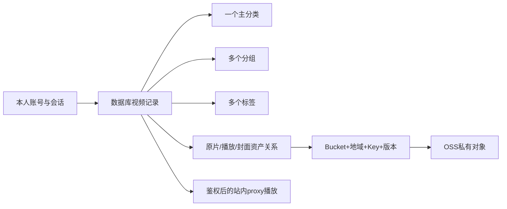

# 第二阶段：三代理任务与新对话入口

日期：2026-10-02。**本次只创建下一阶段任务、数据库变更语句和OSS材料说明，不启动三个代理，不实施应用代码、现有库迁移或真实云操作。** 后续新对话从本文件开始。

## 1. 目前事实与本阶段目标

- CORE-01～03 已有工程、真SQLite Repository、本人密码/TOTP登录与会话；媒体/前端独立模块及Mock已交付。
- 当前默认API入口注册health/auth，真实视频库、观看记录/用量HTTP入口和媒体统一装配仍待完成。上阶段DONE不等于真实全链已验收。
- 用户明确要求：登录与业务都持久化；视频有一个主分类、多个分组与多个标签；上传/导入时选组织信息，数据库管理OSS对象位置及关联；明确SDK和材料。
- 本阶段完成真实HTTP+SQLite的组织/库/上传登记/播放/续播链。内容先可用显式Mock；真OSS、杭州内网、安卓/3Mbps验收分别需要材料、环境与授权，不用Mock冒充。

## 2. 数据与地址模型

| 信息 | 存放位置 |
| --- | --- |
| 登录/密码/TOTP/会话/恢复/失败限流 | 已有users/login_sessions/recovery_codes/login_attempts/audit_events；密码哈希、TOTP密文、Cookie摘要，秘密不进SQL源码 |
| 视频主分类 | categories + videos.category_id（一个主分类） |
| 分组/合集 | library_groups + video_group_links（多个分组） |
| 内容标签 | tags + video_tag_links（多个标签） |
| 上传过程的组织选择 | upload_group_links/upload_tag_links及已有upload_tasks.category_id |
| OSS永久定位/版本/校验 | storage_objects：provider、Bucket、region、objectKey、可选versionId、HEAD元数据 |
| 视频原片/播放/封面与对象 | video_assets；上传对象关联为upload_storage_objects |
| 云操作和登记恢复 | storage_operations + 已有任务/分片状态，登记由SQL事务负责 |



上传得到的Location可用于核对，但数据库长期存完整对象定位，不把过期签名URL当永久地址，不把知晓地址当权限。组/标签是SQLite里的业务信息，不自动映射为OSS目录/对象标签；组织调整不搬移/复制/删除原片。

## 3. 三个子代理与协作门槛

| 代理 | 阶段任务板 | 核心产出 |
| --- | --- | --- |
| 1：后端与数据库 | [.ai/demand/stage2/01-backend.md](.ai/demand/stage2/01-backend.md) | 版本2迁移/契约、组织/库/进度/用量真API、媒体安全注册 |
| 2：OSS与视频 | [.ai/demand/stage2/02-media.md](.ai/demand/stage2/02-media.md) | 完整对象位置、上传组织快照/原子登记、Range/计量、导入/格式、实云条件验收 |
| 3：前端与真实链路 | [.ai/demand/stage2/03-frontend.md](.ai/demand/stage2/03-frontend.md) | 分类/分组/标签UI、真登录/API、上传/筛选/播放/安全页与移动验收 |

**G0**：代理1先完成P2-CORE-01并交接可编译契约/SQL/依赖；代理2/3可同时准备自有设计/Fake，不能抢改共享接口。

**G1**：契约冻结后并行开发；代理1是schema/shared/根锁/API入口唯一写入方，代理2只改media与自有测试，代理3只改apps/web。依赖安装串行；各自任务板各自回写，主控同步TASKS。

**G2**：真SQL+真AuthGuard+明确开发Mock媒体的站内全链；代码已完成、隔离检查、正式迁移、真实OSS、安卓/内网分别有证据。正式迁移先备份/SQL审核/用户授权。

**G3**：用户提供OSS配置并明确实际调用授权后，才执行受控实云验证。无材料时继续本地工作，把实云卡保持TODO列缺项，不无限重试或回退公网。主控串行联调、VS Code运行配置和交接。

## 4. SQL、配置与不变边界

- 已有库升级SQL：[STAGE2_PENDING.sql](../sql/STAGE2_PENDING.sql)；执行前读[SQL说明](../sql/README.md)。新环境基线仍是0001/account:init，已有账号不重建。
- 新空库完整结构与逐行中文说明：[01_EMPTY_DATABASE_FULL.sql](../sql/01_EMPTY_DATABASE_FULL.sql)。仅供手工建结构/学习，不能复制成已有库的0002升级迁移，不写虚假ledger。
- 当前迁移器仅允许版本1；新 SQL 要先接入新增0002/Drizzle/版本校验，再按授权执行。现在不要直接粘贴进现有库，不修改0001哈希、不清空目录/数据库、不自动回滚。
- 当前实际库默认.local/data/video-library.db，不碰sqlite-test.db；用户在数据库工具中打开的文件不强制关闭。
- 新契约提案：[STAGE2_API_CONTRACT](docs/STAGE2_API_CONTRACT.md)；既有[API_CONTRACT](docs/API_CONTRACT.md)保持运行事实，不能把提案接口说成已可用。
- SDK与材料：[OSS_SETUP](docs/OSS_SETUP.md)。本项目用Node.js的ali-oss，非Python；当前已有6.23.0及类型包，下一对话核验后锁定，不默认安装新服务。
- 本地默认Mock、proxy；真实Bucket/目录/角色/网络/费用不猜测。缺安全依赖/预算/对象位置应拒绝，不为“先能跑”采用放行鉴权或虚构成功。
- 不实施Docker/Nginx部署、B直连、PWA离线视频、公开注册/分享或永久删除；不擅自改变云策略/版本控制/清理分片。
- 所有秘密、库/备份、.local、真实.env不进Git/前端/日志。保留已有暂存内容，不自行提交、推送、切分支或改历史。

## 5. 与旧任务的映射

| 旧执行缺口 | 新阶段负责卡 |
| --- | --- |
| CORE-04：分类/库/元数据 | P2-CORE-02/03 |
| CORE-05：进度/会话/用量 | P2-CORE-04，复用CORE-03现有会话 |
| CORE-06：模块装配 | P2-CORE-05/06 |
| MEDIA/WEB上阶段独立模块DONE | 本阶段改造与真实接入，不重写或假设无需验证 |
| INT-01～03 | 主控在本阶段三方交付后执行，真安卓/OSS项按条件补验 |

新对话按阶段2看板逐卡推进，旧任务板保留历史。主控从实际结果更新旧总览映射，避免两套卡重复开发或一方虚报完成。

## 6. 可复制到新对话的主控提示词

```text
在 E:\onlineVideo 开始第二阶段开发。
读取用户全局规则、STAGE2.md、PRD.md、TASKS.md、docs/API_CONTRACT.md、docs/STAGE2_API_CONTRACT.md、docs/sql/README.md、docs/sql/STAGE2_PENDING.sql、docs/OSS_SETUP.md 和三个 .ai/demand/stage2/ 任务板。
本次明确授权代码开发、隔离验证与三个子代理协作；不要重复CORE-01～03或本人账号初始化，检查实际文件/数据库状态。
启动三个子代理：1负责数据库/组织/真实API；2负责OSS/视频/上传登记；3负责前端组织管理与真实链路。
代理1先完成P2-CORE-01并交接可编译契约，代理2/3等待时做自有设计/Fake；冻结后并行。严格文件归属，schema/shared/API入口/根锁唯一写入，安装串行。
按各卡完整范围实施、实际验证后回写真实结果，Mock/真SQL/真实OSS/安卓/内网分别记录。
现有正式库迁移先提供可审阅SQL/目标/一致性备份并获具体授权；不动sqlite-test.db。真实OSS调用先补材料/范围/费用/授权，不改ACL/版本控制、不删除/清理、不部署/B。
缺外部环境时推进本地已可完成部分，实云验收卡保持TODO列缺项，不伪造成功。
完成后主控汇总运行命令、接口/SQL实际变更、验证和待验；保留已有Git暂存，不擅自提交/推送或丢弃改动。
```

给单个代理启动时使用其看板的0/1节和任务总览，指定唯一负责人；不要把三个提示词交给同一代理越界修改所有目录。

## 7. 本轮交付状态

已创建第二阶段任务、契约提案、增量SQL及OSS准备说明；所有P2卡TODO。现有应用源码/账号库/0001未改，未启动额外代理、现有库迁移、真实OSS或部署。
