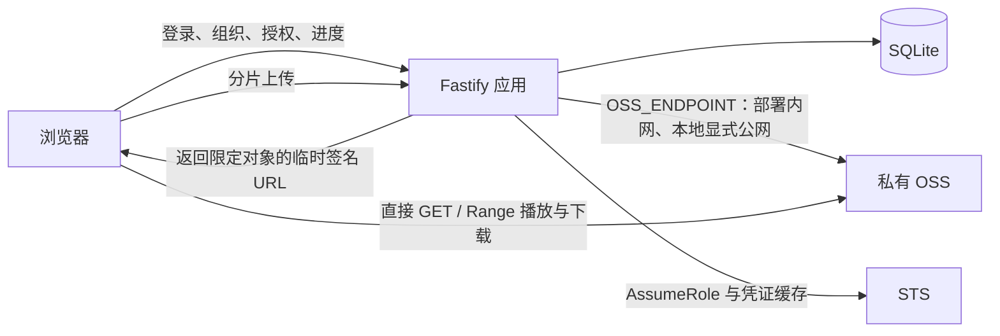

# 第二阶段架构调整评审：服务端上传、OSS 直连播放

日期：2026-10-02。范围：读取现状、SDK/官方文档、用户HTTPS样例匿名HEAD与任务规划；没有修改源码、数据库、云权限或部署配置。HTTPS及剩余准备以[最新启动清单](../OSS_LOCAL_TEST_PLAN.md)为准。

## 1. 结论与依据

第二阶段需要重新规划，但第一阶段工程不需要重建。保留Fastify应用、SQLite Repository、本人密码/TOTP登录、Cookie/CSRF、已有分类页面、上传续传和React页面；组织真实API继续在本阶段实现，将播放链路扩展为显式 `proxy | oss`，真实OSS目标采用 `oss`。

用户完成记录[OSS和框架调整相关](OSS和框架调整相关.md)是架构选择依据，后补[自定义策略JSON](自定义策略的json.txt)及用户确认补全权限事实；旧PRD的A/proxy默认是历史基线，已实现接口仍以[API_CONTRACT](../API_CONTRACT.md)和源码为准，新设计见[STAGE2_API_CONTRACT](../STAGE2_API_CONTRACT.md)。

直连视频流不再经过轻量服务器的 3Mbps 出网。实际速度仍由手机网络、OSS 服务及视频码率决定，OSS 外网下行按实际资源包/账单规则计费。

## 2. 已确认与待验证的事实

| 项目 | 证据与状态 |
| --- | --- |
| Bucket / 地域 / 前缀 | 用户记录xzlbucket/cn-hangzhou/onlineVideo；样例公开地址已HEAD核验，Bucket配置/STS身份仍待验 |
| RAM / 角色 | 用户记录：RAM AK 和角色 ARN 已放入 `.local/secrets/oss.json`、`ARN.txt`；本地仅检查文件存在，未读取或输出秘密 |
| 实际策略与绑定 | JSON允许xzlbucket/onlineVideo/*的GetObject/PutObject及Bucket下受前缀限制的ListObjects；用户明确确认同时绑定RAM用户和角色。初始记录的“只有GetObject”描述已由该材料补充；角色信任及实际AssumeRole/读写仍待实云验收 |
| 域名 / CORS | HTTPS已生效、样例HEAD=200；用户确认公共读，匿名成功符合预期。CORS与本人私有业务范围仍待验，不推断整个Bucket公开 |
| HTTPS | Node默认TLS校验通过，证书到期2026-12-30 23:59:59 UTC；OSS不再待申请，网站自己的证书/域名归第三阶段 |
| Bucket 版本控制 | 用户记录未开启；当前对象 `versionId=null`，保留可选字段及唯一 Key / 防覆盖约束 |
| 依赖 | API 已有 ali-oss 6.23.0 / 类型包 6.23.3；根包新增 multipart 10.1.2 和重复 OSS 依赖，保留用户改动，开发时由代理1核对 workspace 归属与 STS SDK 选型 |
| 实际环境配置 | 本轮未发现根目录 `.env`；记录中的 dotenv 是准备示例，不等于应用已读取配置 |
| 手工 SQL | 只读确认 `sqlite-test.db` 有24张表、users为空、schema_migrations为空；属于手工结构库 |
| 正式运行库 | 只读确认 `.local/data/video-library.db` ledger=1、users=1，尚无分组/标签/对象管理新表；正式升级仍未完成 |

云侧“已准备”与“程序已接入/验收通过”分开记录。不会重复建表到手工库、重建正式账号、切换到空库或伪造迁移记录。

## 3. 第一阶段代码调整范围

| 位置 | 保留内容 | 必要调整 |
| --- | --- | --- |
| `packages/shared/src/dto.ts` | 视频/组织/上传/会话 DTO | 当前 `PlaybackMode` 仅 proxy、sourceUrl 仅 ApiPath；增加模式判别、签名源有效期、续签响应、直连用量状态 |
| `apps/api/src/core/config.ts`、`app.ts`、`server.ts` | 配置入口、日志脱敏、统一装配 | 当前拒绝 oss/production，默认只注册 health/auth；接入完整业务和已校验的 OSS/STS 配置，不能仅删除拒绝逻辑 |
| `apps/api/src/core/contracts/` | AuthGuard、Repo、StorageAdapter 分片/流接口 | 新增独立签名提供者与带到期时间的凭证提供者；对象位置/组织登记由代理1统一冻结 |
| `apps/api/src/modules/media/storage/oss.ts` | 流式上传、背压、取消、对象范围约束 | 上传与签名用途分开；签名 client 固定配置的 CNAME，与上传 Endpoint 无关；隔离 I/O 取消，不能让共享 client 取消其它上传 |
| `apps/api/src/modules/media/playback/` | 会话、归属、创建/心跳/关闭与代理模式 | 增加 STS/V4 URL 发放与续签、下载授权；签发前查 DB 与真实登录，不接受任意 Object Key |
| `apps/api/src/db/` | 已有账号、会话、上传和观看记录 | 接入真实0002迁移及映射；按冻结契约评估是否需要模式/签发到期字段，新增字段也必须迁移管理 |
| `apps/web/src/player.tsx`、API 客户端 | 播放器交互、观看进度、登录态 | 当前硬拒绝外部 sourceUrl；按模式校验允许域名，增加到期续签/恢复位置/错误控制；站内API客户端仍只接受站内路径 |
| `apps/web/src/usage.ts`、安全/用量页 | 真会话与已测代理用量 | 当前仅接受 application_proxy；直连统计不能沿用精确字节/硬封顶展示 |

## 4. 实施时必须处理的边界

### 上传与权限

- 推荐继续使用第一阶段的“创建任务 → 浏览器逐片 SHA-256 → 服务端流式 uploadPart → complete → 原子登记”协议，已有代码符合浏览器→服务器→OSS链路，也支持断点续传，无需因安装 multipart 插件而重写。
- 已安装 ali-oss 的高层 `multipartUpload()` 使用可确定大小/重读的路径、File 或 Buffer，不能直接将一次性 multipart 文件流当成它的输入。普通流使用 `putStream()`；大文件续传优先复用 `initMultipartUpload/uploadPart/completeMultipartUpload`。如额外支持 multipart/form-data，作为显式兼容入口并保留大小、背压、校验及取消限制，不能整文件缓冲或落盘。
- 用户提供的策略同时有PutObject/GetObject及受前缀限制的ListObjects，并已绑定用户和角色，覆盖上传/HEAD/导入所需主要动作；优先复用现有角色获取用途明确的STS，不要求另建角色。AssumeRole的Policy可将签名会话收窄为GetObject、上传/导入会话限定必要动作，缓存按角色+用途+策略隔离。绑定确认不代替信任/权限实效验收，不自动改云策略。
- 未开启版本控制也必须使用服务端唯一 Key 和完成防覆盖校验；不删除原片、分片或失败记录。`versionId` 保留 nullable，不把不存在的版本写入库。

### STS 与签名

- 长期AK只用于服务端受保护用途；浏览器不接收AccessKeySecret/完整STS凭据，播放/下载签名使用收窄为读取用途的STS。签名URL本身会包含临时AccessKeyId/SecurityToken查询项，整体作为敏感临时授权，不打印或长期保存。
- 服务端缓存 STS `Expiration`，提前刷新、并发合并刷新、失败安全返回；刷新失败不能降为长期 AK 签名或匿名 URL。
- 使用 `signatureUrlV4('GET', ...)`，不能仅设置 authorizationV4 后继续调用旧 `signatureUrl()` 并声称 URL 为 V4。本机6.23.0源码中旧方法走旧签名逻辑。
- URL 请求上限按用户要求为3600秒；实际 `sourceExpiresAt = min(签发时间+3600秒, STS到期时间-时钟安全余量)`。缓存中的 STS 可能只剩数分钟，不能每次承诺完整一小时；前端按实际到期续签。
- `OSS_ENDPOINT` 专管服务端上传/HEAD/导入；`OSS_PLAYBACK_ENDPOINT` 专管固定外部域名签名，`cname:true`。本地公网、部署内网切换上传端点不能改变播放域名。
- 媒体已升级HTTPS，本地回环HTTP页面可直连，不回退HTTP。公共读样例仅作HTTPS/格式/Range材料，本人私有视频需另选私有对象验证匿名拒绝/签名成功；CORS/TLS不代替授权。

### 鉴权、撤销与统计

- 使用 `videoId → 本人DB记录 → 已验证资产/对象`，签发与续签都重新检查Cookie、owner、视频状态、会话及授权频率；拒绝客户端传来的任意 bucket/key/URL。
- 签名URL是有效期内可重复使用的临时访问凭证。退出、撤销或关闭应用播放会话能拒绝新的签发/续签，但不会立即撤回已经发出的 URL；刷新 STS 也不会使旧 URL 立即失效。链接过期后已建立传输是否继续，不作立即中断承诺。
- 后端并发限制约束“获批的应用播放会话”，不等于OSS实际连接数；下载授权也单独限频并审计。若以后要求立即撤销全部视频流，需要另行评估云侧机制/代理链路，不在普通直连方案中虚报已实现。
- 代理模式保留已验证的字节预留/结算。OSS模式的实际观看字节在应用侧未知；先显示“OSS直连用量尚未同步”，可记录签发次数/对象大小/应用会话数，不能用文件大小或浏览器估计值充当真实传输量。未来云日志/监控接入属于明确的额外任务，不自动开通或把告警称为费用封顶。
- 下载原片走单独受保护的授权接口，不复用网页“复制地址”作为公开分享功能；视频/原片角色与Content-Disposition在冻结契约中明确。封面可继续受保护的站内小流量读取，避免第一轮扩大刷新设计。

## 5. 开发顺序与待办

1. **G0 / 代理1**：正式库只读对照与0002迁移方案，冻结 proxy/oss 播放、续签/下载、STS提供者、直连用量及对象/组织登记契约；隔离验证后交接。
2. **G1 / 代理2与3**：媒体实现上传身份/读取身份分离、STS缓存、V4签名和续签；前端实现域名校验、直连播放/下载与到期恢复。公共类型/入口/根锁只有代理1写入。
3. **G2 / 主控**：真SQLite、真AuthGuard和独立本地OSS协议服务验证全链；正式库迁移在备份/SQL审阅及具体授权后执行，不重复用户已执行的手工建表。
4. **G3 / 实云条件**：样例公开原因已确认；核验本人私有视频范围、角色信任/AssumeRole、Get/Put/List、CORS及具体费用/范围，另以私有对象验收签名链。媒体HTTPS就绪，网站/安卓/杭州内网归第三阶段。

三个任务板保留原任务ID和TODO状态，调整实施要求及验收条件；第一阶段DONE作为历史模块交付保留，不改写成OSS直连已验。

## 6. 核验来源

核验日期：2026-10-02，通过 Exa 读取阿里云官方文档，并对照本机 ali-oss 6.23.0 的 `managed-upload.js`、`signatureUrl.js`、`signatureUrlV4.js`。

- [STS缓存及STS/签名有效期取最小值](https://help.aliyun.com/zh/oss/developer-reference/authorize-access-6)
- [Node.js V4下载签名、有效期内重复访问及HTTPS](https://help.aliyun.com/en/oss/developer-reference/download-objects-using-a-presigned-url-generated-with-oss-sdk-for-node-js)
- [Node.js流式上传 putStream](https://help.aliyun.com/zh/oss/developer-reference/streaming-upload-1)
- [Multipart完成权限与防覆盖边界](https://help.aliyun.com/zh/oss/developer-reference/completemultipartupload)
- [AssumeRole角色信任及会话策略取交集](https://help.aliyun.com/zh/ram/developer-reference/api-sts-2015-04-01-assumerole)
